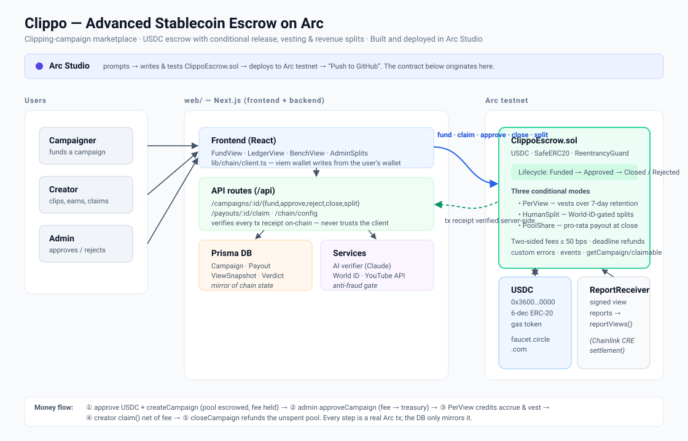
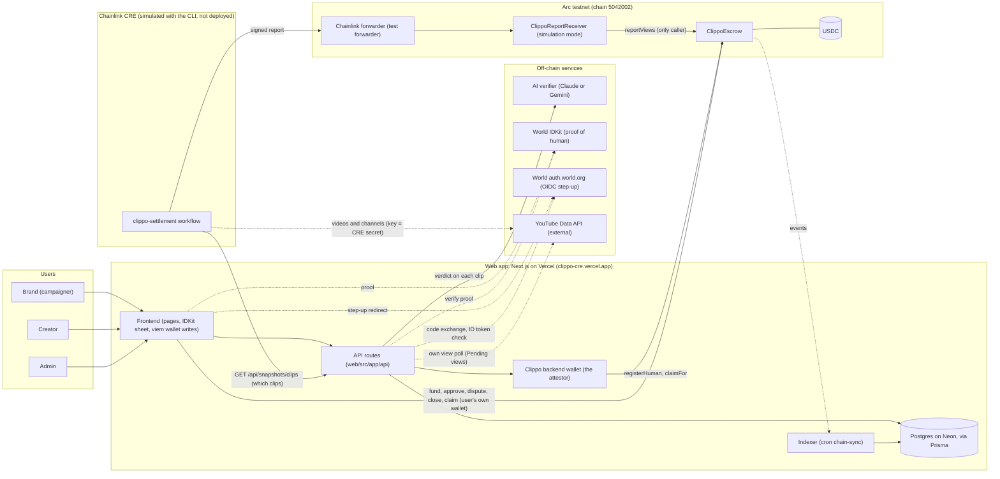
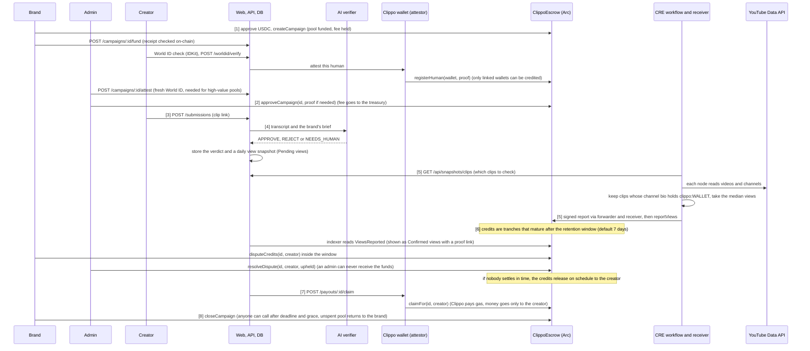
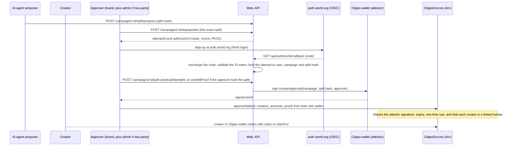

# Architecture

`architecture.svg` is the picture of the design below. The two Mermaid diagrams (system, money flow) say the same thing in text form. Numbers 1 to 8 on the green arrows in the SVG are the money-flow steps.

Status in one line: the escrow, the receiver and one CRE report ran on real Arc testnet. The CRE workflow is simulated with the CLI and not deployed on the CRE network, the receiver is in simulation mode, the deployed site is seeded with labelled `[SEED]` rows, and World ID has not run against the real portal or issuer.

## System

Solid arrows are calls or transactions, dotted arrows are reads, polls or calls to services outside Clippo. An agent proposes, it never moves money alone: the AI verdict only gates a clip, and a HumanSplit needs a human step-up and a signed approval. The web-to-escrow calls are real viem transactions when `ESCROW_ADDRESS` is set. Without it the chain routes answer 503 `NOT_CONFIGURED`.

## Money flow

Per-view campaign (contract in `contracts/src/ClippoEscrow.sol`). Numbers in square brackets match the numbered arrows in `architecture.svg`.

HumanSplit campaigns have no CRE step. The credits come from `approveSplit`:

## What is real, simulated, seeded or unproven

| Piece | Status |
| --- | --- |
| Contracts: `ClippoEscrow` and `ClippoReportReceiver` | Real. Foundry tests (114 passed, BUILD_LOG 21) and built with `forge script`, not Arc Studio. Deployed on Arc testnet: escrow `0x1e05373c199D764f7dE0353d58AFEa2b4C6326Ef`, receiver `0x6b0f6C0f324C615Add6BfcA5EE0b8eeD66F2C0cd` (BUILD_LOG 17, read back from the chain). Two older escrows from the earlier design (no attestor, disputes or `claimFor`) are also on Arc testnet and are not used: `0xd8453c22996bea11598a3dbf05112675b945c39c`, `0xc7b9588ee0a4bff31e17ece1141ea404ad05e310`. |
| Receiver | Simulation mode. It trusts Arc's Chainlink test forwarder and our own simulation wallet as the workflow owner, and its workflow check is skipped for the mock forwarder. It is not locked. The locked setup (real forwarder, workflow id, `lockConfig`) needs a deployed workflow. |
| CRE workflow | Simulated with the CRE CLI, not deployed on the CRE network. One report ran on real Arc testnet through the receiver (tx `0xa41f91daf5431332ecaf1fbdfbf7f8ca13a38d39de8c41d0c1291f229f5c8409`, BUILD_LOG 18, reading the real YouTube video and channel bio). It was one node, the report was sent by our simulation wallet through the test forwarder, and the manifest came from a local mock backend. `cre/workflows/clippo-settlement/config.production.json` holds the real receiver and the deployed site URL. |
| Deployed site (https://clippo-cre.vercel.app) | Real code on Vercel with a Neon database, reading the real escrow on Arc. The user, channel, campaign, clip and approval rows are seeded and labelled `[SEED]` (`web/scripts/seed-cre-demo.mjs`). The views, the credit and the proof link are real: the campaign page shows Confirmed views from the real CRE transaction (BUILD_LOG 20). The AI verifier, World ID, admin list and blob storage are not configured there. It was redeployed from `main` at `ab35b35` on 2026-11-07 (after the merge with the teammate's World ID step-up; that migration is applied on its database). The live manifest lists a clip only after its approval day has ended (UTC). |
| Confirmed and Pending views | The indexer reads `ViewsReported` events. Pages show Confirmed views (on-chain, with a proof link to the Arc explorer) next to Pending views (Clippo's own YouTube poll, not yet confirmed). Proven on a local fork and on the deployed site. |
| Wallet transactions from the app | Real viem calls when `ESCROW_ADDRESS` is set. Fund, approve and claim from the app have not run against real Arc. Fake hashes (`0xdemo...`) appear only in a `NEXT_PUBLIC_DEMO=1` build with no escrow. The server reads every receipt on-chain before it updates the DB. |
| `registerHuman`, approvals with proof, disputes, `claimFor`, HumanSplit | In the contracts, tested, and wired in the web code. Not run end to end on real Arc. |
| World IDKit (proof of human) | Wired in code (`IDKitSheet.tsx`, `/api/worldid/rp-signature`, `/api/worldid/verify`). Not run against the real Developer Portal. World ID proofs for the prize are mocked or staging identities, not for production. |
| World auth.world.org OIDC step-up | Implemented and tested with doubles only. It has not run against the real issuer, because the client registration is blocked. |
| AI verifier | Code and tests. Not configured on the deployed site. |
| Not built or not used | Crosschain transfers, Arc Studio, a mobile app. `ClippoReferral` and `ClippoCreatorProfile` modules exist but are off by default (feature flags) and are not part of this design. |

Who can move money:

- `reportViews` accepts only the report adapter (the CRE receiver, set once). The receiver accepts only the Chainlink forwarder plus its workflow checks.
- HumanSplit credits need an attestor signature bound to the exact split. The attestor (`humanAttestor`) is fixed at deploy and cannot move funds or choose who gets paid.
- Only wallets linked to a human (`registerHuman`, `humanOf`) can be credited.
- A payout, by `claim` or `claimFor`, can only reach the creator who earned it. Admins approve, reject and settle disputes but can never receive funds.
- PerView credits are tranches that wait the retention window (7 days by default). The brand can dispute them in that window. If nobody settles a dispute in time, the credits release to the creator.
- Reject refunds the full pool including the held fee. `reclaimUnapproved` does the same after the deadline if no admin approved. `closeCampaign` returns the unspent pool to the brand.

## Components to files

| Component | Files |
| --- | --- |
| Frontend | `web/src/app/(site)/*`, `web/src/components/*`, data seam `components/api.ts`, wallet writes `components/hooks.ts` (`useEscrow()`) and `web/src/lib/chain/client.ts` |
| API | `web/src/app/api/**/route.ts`, `web/src/lib/{auth,http,domain,earnings,snapshots}.ts` |
| Database | `web/prisma/schema.prisma` (Postgres, Neon in production; models include User, Channel, Campaign, Submission, Verdict, ViewSnapshot, ViewsReport, Payout and more) |
| AI verifier | `web/src/lib/ai/{verifier,llm,duplicates,campaign-writer}.ts` (provider switch `LLM_PROVIDER`: Anthropic or Gemini) |
| World IDKit | `web/src/lib/worldid/index.ts`, `web/src/app/api/worldid/{verify,rp-signature}/route.ts`, `components/{WorldCheck,IDKitSheet}.tsx` |
| World OIDC step-up | `web/src/lib/worldauth/*`, `web/src/app/api/campaigns/[id]/stepup/start/route.ts`, `web/src/app/api/auth/world/callback/route.ts`, `web/src/app/api/stepup/[attemptId]/route.ts`, `components/StepUpApprove.tsx` |
| Clippo backend wallet (attestor) | `web/src/lib/chain/clippo-wallet.ts` (signs approvals and `registerHuman`, sends `claimFor`, key `HUMAN_ATTESTOR_PRIVATE_KEY`), used by `web/src/app/api/payouts/[id]/claim/route.ts` and `web/src/app/api/campaigns/[id]/split/route.ts` |
| Own view poll | `web/src/lib/youtube/index.ts`, `web/src/lib/platforms/{index,x,instagram}.ts` (Pending views) |
| Escrow and receiver | `contracts/src/ClippoEscrow.sol`, `ClippoReportReceiver.sol`, `MockUSDC.sol` (tests only), `script/Deploy.s.sol` (Foundry + `forge script`) |
| Disputes | `contracts/src/ClippoEscrow.sol` (`disputeCredits`, `resolveDispute`), `web/src/app/api/chain/disputes/route.ts`, `components/OnchainDisputes.tsx` |
| CRE workflow | `cre/workflows/clippo-settlement/{main,config,snapshot,youtube}.ts`, manifest `web/src/app/api/snapshots/clips/route.ts` (the older frozen feed `web/src/app/api/snapshots/daily/route.ts` is no longer read by the workflow) |
| Indexer and Confirmed views | `web/src/lib/chain/indexer.ts` (reads escrow events, run by the `chain-sync` cron and `POST /api/chain/sync`), `web/src/lib/confirmed.ts`, `web/src/components/ConfirmedViews.tsx` |
| Deployed-site seed | `web/scripts/seed-cre-demo.mjs`, steps in `docs/CRE_DEPLOY.md` |
