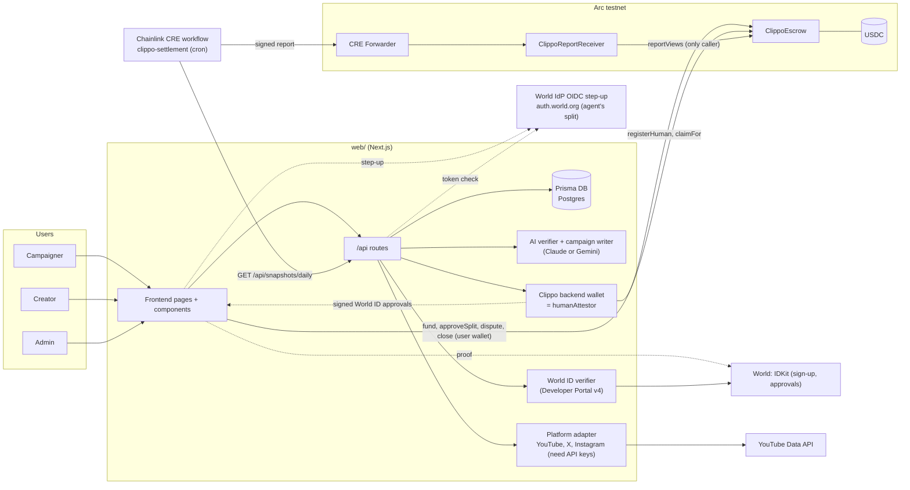
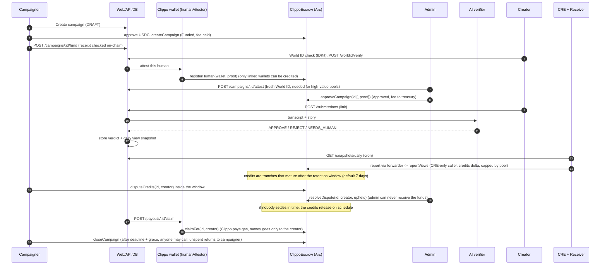
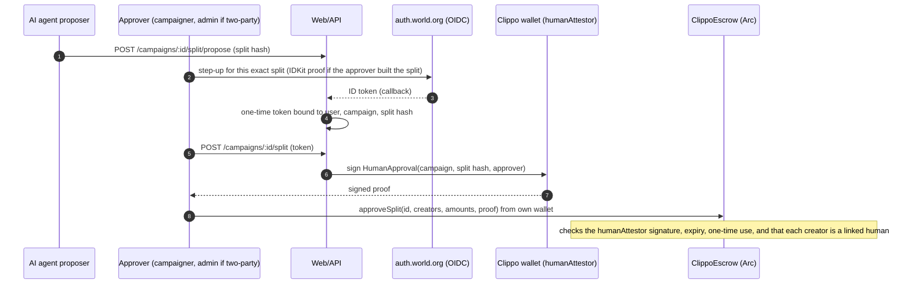

# Architecture

## System

Dotted links have not been run against the real World Developer Portal or the real auth.world.org issuer. The CRE workflow has been simulated only (single node, local fork), not deployed. Nothing in this diagram has run end to end on real Arc with the enforcing escrow, which is not deployed.

Diagram note: `docs/architecture.svg` still shows the older design (no humanAttestor, registerHuman, disputes or OIDC step-up in the drawing; only the footer text mentions claimFor). Only its false text was fixed. Use the diagrams on this page for the current design.

## Money flow

Per-view campaign, current design (contract in `contracts/src/ClippoEscrow.sol`, commit 498f649).

HumanSplit campaigns have no CRE step. The credits come from `approveSplit`:

What is real in these flows:

- Contract: all steps above exist in `ClippoEscrow.sol` and have Foundry tests. The enforcing escrow (commit 498f649) is not deployed anywhere. The live site (`clippo-six.vercel.app/api/chain/config`) points at the older escrow `0xd8453c22996bea11598a3dbf05112675b945c39c`, which has no humanAttestor, disputes or claimFor. A second older escrow, `0xc7b9588ee0a4bff31e17ece1141ea404ad05e310`, also has code on Arc testnet (an earlier version of `docs/SUBMISSION_ARC.md` cited it). Both are the older design.
- Web: wallet transactions are real viem writes (`web/src/lib/chain/client.ts`, `useEscrow()` in `components/hooks.ts`). Fake tx hashes (`0xdemo...`) appear only in a `NEXT_PUBLIC_DEMO=1` build with no escrow configured. Without `ESCROW_ADDRESS` and without that flag, money-moving calls refuse with an error. The server reads every receipt on-chain before it updates the DB. The web code for the enforcing escrow (292d107, dfd0d51) has not run against real Arc. The live site still runs the older build.
- Who can move money: `reportViews` accepts only the report adapter (the CRE receiver). HumanSplit credits need a `humanAttestor` signature bound to the exact split. `humanAttestor` is fixed at deploy. Admins approve, reject and settle disputes but cannot send funds to themselves.
- World ID: IDKit v4 is wired in code (`IDKitSheet.tsx`, `/api/worldid/rp-signature`, `/api/worldid/verify`). It has not been run against the real Developer Portal. The OIDC step-up (`web/src/lib/agentpass/stepup.ts`, `/api/agentpass/stepup/*`) was tested against a local fake issuer only, not against auth.world.org and not in a browser. World ID proofs for the prize are mocked fake identities, not for production.
- HumanSplit: the backend does not send `approveSplit`. Each approver sends it from their own wallet. The DB split is `AWAITING_CHAIN` until the `SplitFinalized` event is read.
- Reject path: `rejectCampaign` on-chain refunds the full pool including the held fee. `reclaimUnapproved` does the same for the campaigner after the deadline if no admin approved.
- CRE: the workflow reads Clippo's frozen daily snapshot feed (`/api/snapshots/daily`), not YouTube directly. It simulates (6f74f7b). A live-feed run exits 0 with an empty no-op. A local `--broadcast` run on an anvil fork of Arc credited creators. Nothing was broadcast to real Arc, no workflow is deployed, and the simulator is single-node with no real consensus. `cre/workflows/clippo-settlement/config.production.json` still has a zero `receiverAddress`.
- Feed ids: the feed emits the numeric `onchainId` as `campaignId` (`web/src/lib/snapshots.ts`, 292d107), so the old id gap is closed in code. A run with real rows through a deployed receiver has not been done.

## Components to files

| Component | Files |
| --- | --- |
| Frontend | `web/src/app/(site)/*`, `web/src/components/*`, data seam `components/api.ts` |
| API | `web/src/app/api/**/route.ts`, `web/src/lib/{auth,http,domain,earnings,snapshots}.ts` |
| DB | `web/prisma/schema.prisma` (User, Channel, Campaign, Submission, Verdict, ViewSnapshot, Payout, and more) |
| AI verifier | `web/src/lib/ai/{verifier,llm,duplicates,campaign-writer}.ts` |
| World ID | `web/src/lib/worldid/index.ts`, `web/src/app/api/worldid/{verify,rp-signature}/route.ts`, `components/{WorldCheck,IDKitSheet}.tsx`; OIDC step-up: `web/src/lib/agentpass/stepup.ts`, `web/src/app/api/agentpass/stepup/{start,callback}/route.ts` |
| Backend wallet (humanAttestor) | `web/src/lib/chain/clippo-wallet.ts` (signs approvals, `registerHuman`, `claimFor`; key `HUMAN_ATTESTOR_PRIVATE_KEY`) |
| Platforms | `web/src/lib/platforms/{index,x,instagram}.ts`, `web/src/lib/youtube/index.ts` |
| Escrow | `contracts/src/ClippoEscrow.sol`, `ClippoReportReceiver.sol`, `MockUSDC.sol`, `script/Deploy.s.sol` |
| CRE | `cre/workflows/clippo-settlement/{main,snapshot}.ts`, feed `web/src/app/api/snapshots/daily/route.ts` |
