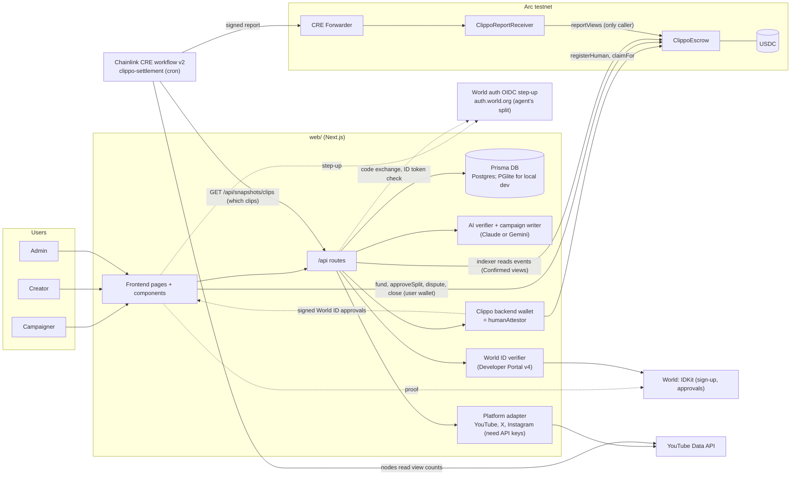
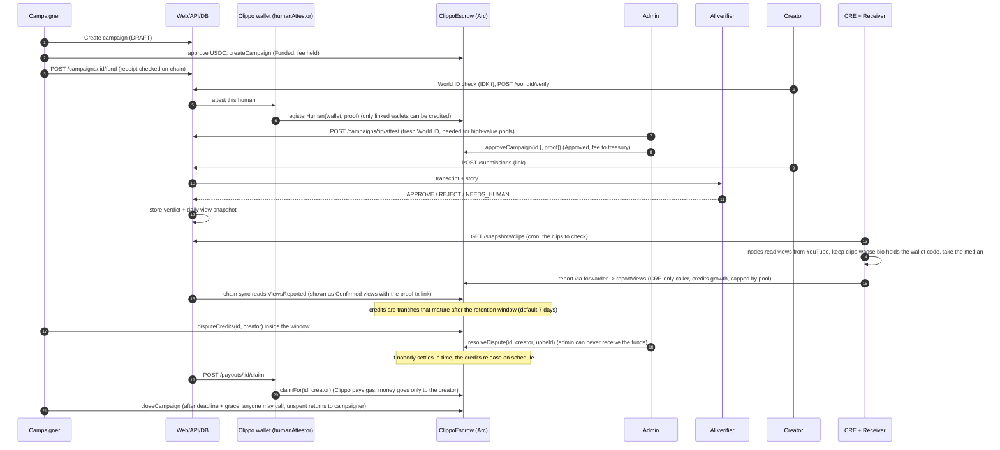
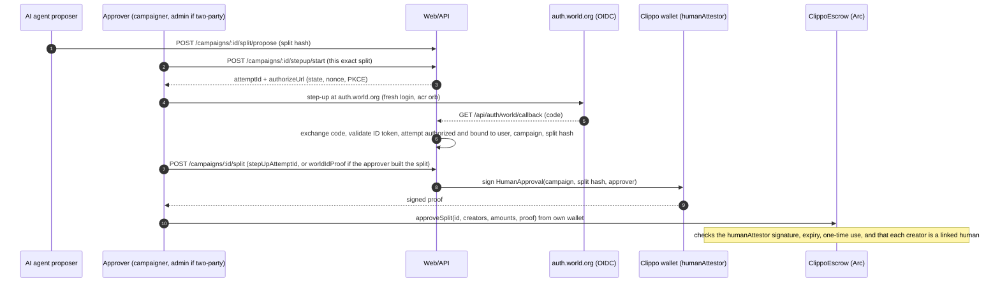

# Architecture

## System

Dotted links are client-side calls (browser wallet and IDKit) or calls to World services. The web-to-escrow calls are real viem transactions when `ESCROW_ADDRESS` is set; without it chain routes answer 503 `NOT_CONFIGURED`. The dotted World links have not been run against the real World Developer Portal or the real auth.world.org issuer. The CRE workflow has been simulated only (single node): locally on an anvil fork, and once on real Arc testnet against the enforcing escrow (simulation mode: our own simulation wallet sent the report through Arc's Chainlink test forwarder; tx `0xa41f91daf5431332ecaf1fbdfbf7f8ca13a38d39de8c41d0c1291f229f5c8409`). It is not deployed. The enforcing escrow `0x1e05373c199D764f7dE0353d58AFEa2b4C6326Ef` and the receiver `0x6b0f6C0f324C615Add6BfcA5EE0b8eeD66F2C0cd` are on Arc testnet; the rest of this diagram (World ID approvals, disputes, `claimFor`, HumanSplit) has not run end to end on real Arc.

Diagram note: `docs/architecture.svg` still shows the older design (no humanAttestor, registerHuman, disputes or OIDC step-up in the drawing; only the footer text mentions claimFor). Only its false text was fixed. Use the diagrams on this page for the current design.

## Money flow

Per-view campaign, current design (contract in `contracts/src/ClippoEscrow.sol`, commit 498f649).

HumanSplit campaigns have no CRE step. The credits come from `approveSplit`:

What is real in these flows:

- Contract: all steps above exist in `ClippoEscrow.sol` and have Foundry tests. The enforcing escrow (commit 498f649) is deployed on Arc testnet in simulation mode: escrow `0x1e05373c199D764f7dE0353d58AFEa2b4C6326Ef`, receiver `0x6b0f6C0f324C615Add6BfcA5EE0b8eeD66F2C0cd` (`docs/BUILD_LOG.md` entry 17, read back from the chain). Only the deploy steps, one CRE report and the indexer sync have run on it; World ID proof approvals, disputes and `claimFor` have not. Two older escrows with the old design (no humanAttestor, disputes or claimFor) also exist on Arc testnet: `0xd8453c22996bea11598a3dbf05112675b945c39c` (what the old clippo-six site pointed at) and `0xc7b9588ee0a4bff31e17ece1141ea404ad05e310` (an earlier version of `docs/SUBMISSION_ARC.md` cited it).
- Web: every step on `ClippoEscrow` is sent with real viem calls (`web/src/lib/chain/client.ts`, `useEscrow()` in `components/hooks.ts`) when `ESCROW_ADDRESS` is set; otherwise the chain routes answer 503 `NOT_CONFIGURED`. Fake tx hashes (`0xdemo...`) appear only in a `NEXT_PUBLIC_DEMO=1` build with no escrow configured. The server reads every receipt on-chain before it updates the DB (`web/src/lib/chain`). The deployed test site https://clippo-cre.vercel.app (Vercel CLI, built from the feature branch; to be redeployed from main after the merge) reads the escrow on real Arc and its indexer synced real Arc events (BUILD_LOG 20). Wallet transactions from the app (fund, approve, claim) have not run against real Arc.
- Who can move money: `reportViews` accepts only the report adapter (the CRE receiver). HumanSplit credits need a `humanAttestor` signature bound to the exact split. `humanAttestor` is fixed at deploy. Admins approve, reject and settle disputes but cannot send funds to themselves.
- World ID: IDKit v4 is wired in code (`IDKitSheet.tsx`, `/api/worldid/rp-signature`, `/api/worldid/verify`). It has not been run against the real Developer Portal. The auth.world.org step-up (`web/src/lib/worldauth/*`, `POST /api/campaigns/:id/stepup/start`, `GET /api/auth/world/callback`, `GET /api/stepup/:attemptId`) is implemented in code and tested with doubles only: it has not run against the real issuer, because the client registration is blocked. World ID proofs for the prize are mocked fake identities, not for production.
- HumanSplit: `POST /api/campaigns/:id/split` needs a fresh human check from each approver (`stepUpAttemptId` for an agent's proposal, `worldIdProof` for a split the approver built; see `WORLD_AUTH_POLICY`). The backend does not send `approveSplit`. Each approver sends it from their own wallet with the signed `proof` the API returns. The DB split is `AWAITING_CHAIN` until the `SplitFinalized` event is read.
- Reject path: `rejectCampaign` on-chain refunds the full pool including the held fee. `reclaimUnapproved` does the same for the campaigner after the deadline if no admin approved.
- CRE (workflow v2): each node reads the clip manifest `GET /api/snapshots/clips` and the view counts from the YouTube Data API itself, keeps a clip only if the channel bio holds `clippo:<wallet>`, and the nodes agree on the median. It simulates: locally on an anvil fork, and once on real Arc testnet (tx `0xa41f91daf5431332ecaf1fbdfbf7f8ca13a38d39de8c41d0c1291f229f5c8409`, BUILD_LOG 18). Not proven: that run was one node, the report was sent by our own simulation wallet through Arc's Chainlink test forwarder, and the manifest came from a local mock backend. No workflow is deployed and the receiver is not locked. `cre/workflows/clippo-settlement/config.production.json` has the real receiver.
- Confirmed and Pending views: the indexer reads `ViewsReported` events. The campaign page, ledger and desk show Confirmed views (on-chain, with the proof link and a Chainlink badge) beside Pending views (Clippo's own YouTube count, not yet confirmed). The deployed site showed the real-Arc result (BUILD_LOG 20).
- Manifest ids: `/api/snapshots/clips` emits the numeric `onchainId` as `campaignId` (`web/src/lib/snapshots.ts`), so the old id gap is closed in code. One real row has gone through the deployed receiver, in the simulation above.

## Components to files

| Component | Files |
| --- | --- |
| Frontend | `web/src/app/(site)/*`, `web/src/components/*`, data seam `components/api.ts` |
| API | `web/src/app/api/**/route.ts`, `web/src/lib/{auth,http,domain,earnings,snapshots}.ts` |
| DB | `web/prisma/schema.prisma` (Postgres datasource; models include User, Channel, Campaign, Submission, Verdict, ViewSnapshot, Payout and more) |
| AI verifier | `web/src/lib/ai/{verifier,llm,duplicates,campaign-writer}.ts` (provider switch `LLM_PROVIDER`: Anthropic or Gemini) |
| World ID | `web/src/lib/worldid/index.ts`, `web/src/app/api/worldid/{verify,rp-signature}/route.ts`, `components/{WorldCheck,IDKitSheet}.tsx`; auth.world.org step-up: `web/src/lib/worldauth/*`, `web/src/app/api/campaigns/[id]/stepup/start/route.ts`, `web/src/app/api/auth/world/callback/route.ts`, `web/src/app/api/stepup/[attemptId]/route.ts`, `components/StepUpApprove.tsx` |
| Backend wallet (humanAttestor) | `web/src/lib/chain/clippo-wallet.ts` (signs approvals, `registerHuman`, `claimFor`; key `HUMAN_ATTESTOR_PRIVATE_KEY`) |
| Platforms | `web/src/lib/platforms/{index,x,instagram}.ts`, `web/src/lib/youtube/index.ts` |
| Escrow | `contracts/src/ClippoEscrow.sol`, `ClippoReportReceiver.sol`, `MockUSDC.sol`, `script/Deploy.s.sol` |
| CRE | `cre/workflows/clippo-settlement/{main,config,snapshot,youtube}.ts`, manifest `web/src/app/api/snapshots/clips/route.ts` (the older frozen feed `web/src/app/api/snapshots/daily/route.ts` is no longer read by the workflow) |
| Confirmed views | `web/src/lib/chain/indexer.ts` (reads `ViewsReported`), `web/src/components/ConfirmedViews.tsx` |
